# From Vibe to Verified: lab guide

DevFest Bangkok, Sun 15 Nov 2026, 13:00. 60 minutes. You build a small Q&A board with an AI agent,
prove it works, and publish it on Cloud Run.

You use: Google Antigravity CLI (`agy`) with **Gemini 4 Argon**, paid by the event credit through
your own Google Cloud project (Agent Platform), Google's Conductor plugin (spec, plan, build) and our
`verified` plugin (verify step, `VERIFY.md`). The core of the app (`src/core/`) is locked, so the
agent can only write the edges (the UI in `src/ui/`). No credit, or want to run the build again? Use
the free **Gemini 3.8 Flash** instead (the box in section 2.1).

**You work in Google Cloud Shell**: a Linux terminal in your browser, with Node, git and the Google
Cloud CLI already installed. Nothing to install on your laptop. Setup takes 5-10 minutes in the
room (section 0). Cannot use Cloud Shell (under 18, Google does not know your age, or only a work
account)? Use [Appendix A: install on your own laptop](#appendix-a-install-on-your-own-laptop) or
the [fallback box](#fallback-box-no-terminal-works-for-you).

Three human gates. The agent stops at each one and waits for you:

- **Gate 1 spec approved**
- **Gate 2 plan approved**
- **Gate 3 VERIFY.md accepted**

To save time, the spec and the plan are already written on branch `step-1-spec`. You read them and
pass Gates 1 and 2 yourself, then the agent builds.

| Min | Stage | Section | Jump point if stuck |
|---|---|---|---|
| before 0 | Set up Cloud Shell: install `agy`, your git name, clone the starter, plugins | 0 | none |
| 0-5 | Claim the cloud credit, make and link your project, enable the services, point `agy` at your project (may use the start buffer) | 1 | none |
| 5-10 | Start `agy` on Gemini 4 Argon, read spec and plan, approve | 2 | `step-1-spec` |
| 10-40 | Build and verify: the agent writes the edges on the locked core, runs `/verify`, you check the lock and accept `VERIFY.md` | 3-4 | `step-3-build`, `step-4-verified` |
| 40-50 | Publish: `gcloud run deploy`, open your own URL | 5 | `step-5-deployed` |
| 50-58 | Speaker demo: push, pipeline, deploy | 6 | none |
| 58-60 | Wrap | 6 | none |

> **Stuck? Out of credit? Jump to a checkpoint.** Every stage ends in a branch that already has
> the result of that stage. Run `git switch step-N-name` (names are in each stage box) and carry on
> from the next stage. If `git switch` complains about local changes, run `git stash -u` first.
> Fallback if nothing works for you: see the box at the end.

---

## Before the event (organiser fills in)

- [x] GitHub org: `opsta` (repos `opsta/antigravity-verified` and `opsta/vibe-to-verified-starter`)
- [ ] Claim link and QR code on the screen (section 1); attendees make their own project and link it to the credit

---

## 0. Set up Cloud Shell (before minute 0, 5-10 minutes)

### 0.1 Open Cloud Shell

Open https://shell.cloud.google.com and sign in with your personal `@gmail.com` (you must be 18 or
older). The first time you use it:

- tick the box to accept the Google Cloud terms of service and click **Start Cloud Shell**,
- if it says **Verify your account**, click **Verify** and finish the check on your phone (scan the
  QR code, or get an SMS code), then go back and click **Refresh**, and
- click **Authorize** when the "Authorize Cloud Shell" dialog asks (it appears the first time a
  command needs your account).

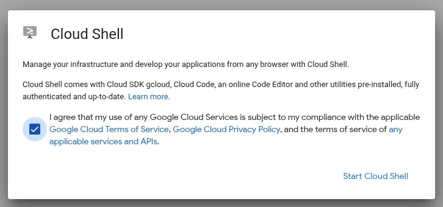

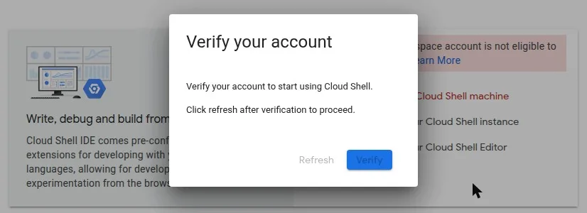

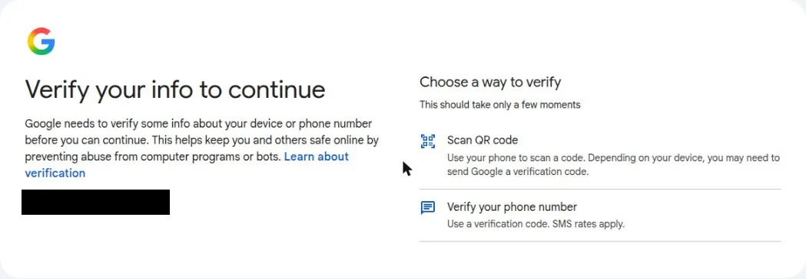

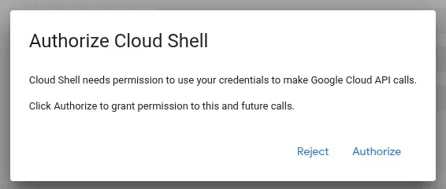

Leave **ephemeral mode off** (Default mode, that is the default): ephemeral mode throws your files
away. The first start of the day can take 2-3 minutes; after that it opens in seconds.

### 0.2 Install `agy`

Cloud Shell already has an older `agy` in `/usr/bin`. Install the current one with the official
installer, then reload your shell so the new one comes first:

```sh
curl -fsSL https://antigravity.google/cli/install.sh | bash
source ~/.bashrc
agy --version
```

The installer prints a few lines starting with `ERROR: logging before google.Init` and a warning
that the folder is not in your `PATH`. Both are harmless: `source ~/.bashrc` fixes the `PATH`.

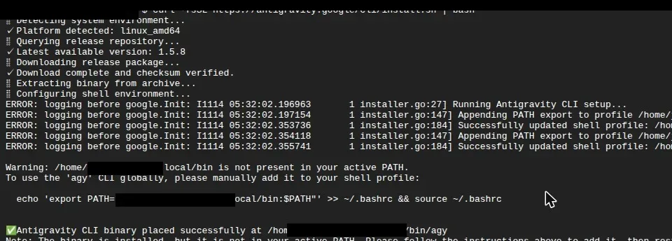

Expected: version 1.5 or newer. Still 1.4? You are running the old one: run `source ~/.bashrc` again.
Do not start `agy` yet: you point it at your own project in section 1 first.

### 0.3 Your git name, the starter and the plugins

Conductor commits each task, and a new Cloud Shell has no git name yet. Set your own (any name and
e-mail you like), so the agent never has to invent one or copy someone else's:

```sh
git config --global user.name "Your Name"
git config --global user.email "you@example.com"
```

Get the starter and check that it is healthy:

```sh
git clone --branch step-1-spec https://github.com/opsta/vibe-to-verified-starter
cd vibe-to-verified-starter
npm ci
npm run verify:contract
echo $?
```

Expected: the last command prints `0`. `npm ci` may report "vulnerabilities" and suggest
`npm audit fix`: ignore it. **Never run `npm audit fix`**: it changes the locked `package.json`
and `package-lock.json`.

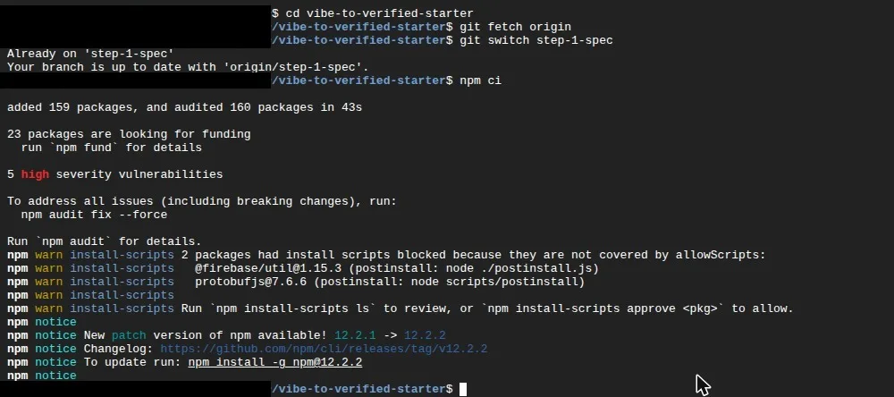

Install the two plugins (a new Cloud Shell does not have them) and check:

```sh
agy plugin install https://github.com/gemini-cli-extensions/conductor
agy plugin install https://github.com/opsta/antigravity-verified
agy plugin list
```

Expected: `conductor` and `verified` appear. Cloud Shell also lists three Google plugins that come
with it; that is fine.

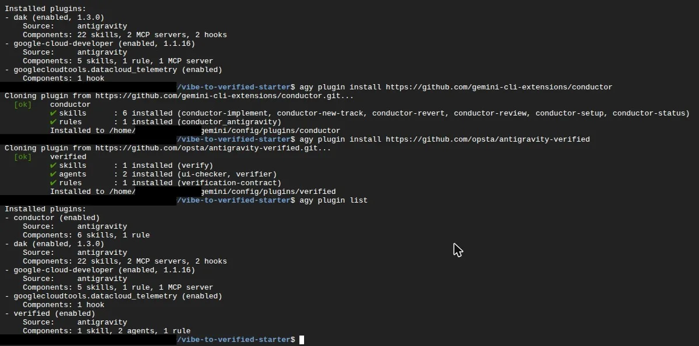

Cloud Shell keeps your home folder, so if the tab disconnects, open it again and run
`cd vibe-to-verified-starter`.

---

## 1. Claim the credit and make your project (minutes 0-5)

This step may use the start buffer before minute 0. You need a smartphone for one check.

1. Open the claim link shown on the screen (or scan the QR code on the slide) on your laptop.
2. Sign in with your personal `@gmail.com` (the same account as Cloud Shell).
3. A Google Developer Program profile is required. If you are asked, click **Create profile** and
   finish it.
4. Scan the QR code the page shows with your smartphone to prove you are human.
5. Click **Claim Credit**. No card is needed.

   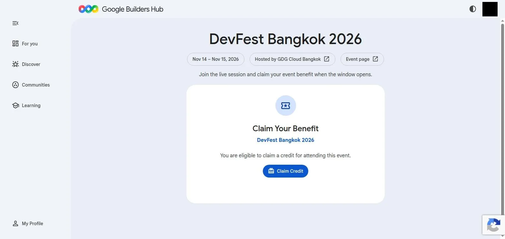

6. Wait 3-5 minutes. Then click **Open Billing Account**. The credit is a new billing account named
   `GDP Event Credit: DevFest Bangkok 2026`. It is not a project: you make the project yourself below.

   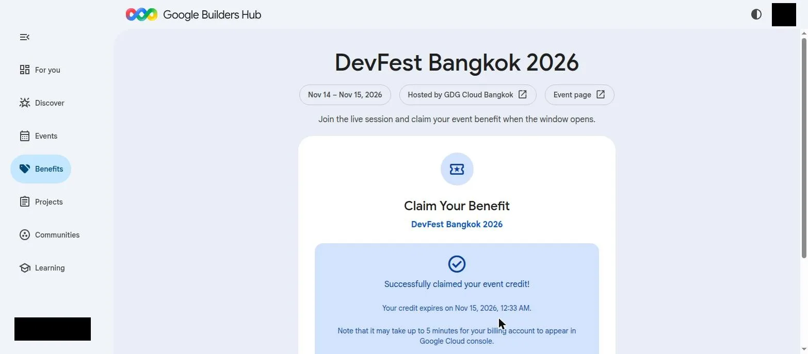

7. First visit to the Cloud console: a Welcome dialog asks for your country and the Terms of
   Service. Tick the Terms box (the e-mail box is optional) and click **Agree and continue**.
   **Do not click "Start free"** on the $300 Free Trial banner: it asks for a card and you do not
   need it.

   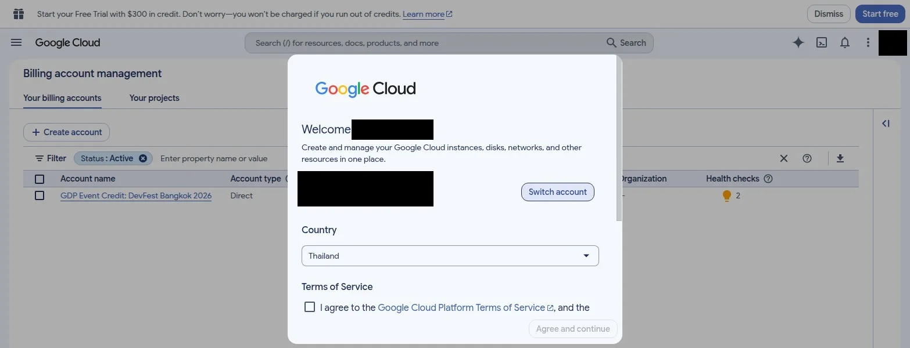

   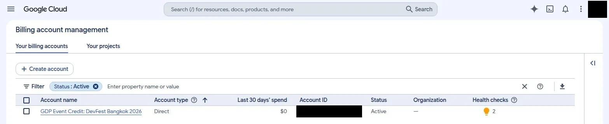

The credit lasts about 12 hours, so your published app stops the day after.
If the claim fails, do not worry: use free Flash (section 2.1) and the fallback box at the end for
the deploy.

Then, still in minutes 2-5, in Cloud Shell: make a project, link it to the credit, point the Google
Cloud CLI at it and enable the services now. Why now: the APIs need about a minute before the first
deploy works, so by section 5 they are ready.

In Cloud Shell, `gcloud config set project` does not last: every new tab or reconnect starts a fresh
gcloud configuration. So put the project in `~/.bashrc` instead, where every tab picks it up.

```sh
gcloud billing accounts list
BILLING_ACCOUNT=$(gcloud billing accounts list --filter="open=true AND displayName~GDP" \
  --format="value(name.basename())" | head -n 1)
echo "$BILLING_ACCOUNT"
PROJECT_ID="vtv-$(date +%s)-$RANDOM"
gcloud projects create "$PROJECT_ID"
gcloud billing projects link "$PROJECT_ID" --billing-account="$BILLING_ACCOUNT"
echo "export CLOUDSDK_CORE_PROJECT=$PROJECT_ID" >> ~/.bashrc
source ~/.bashrc
gcloud config get-value project
gcloud services enable run.googleapis.com cloudbuild.googleapis.com artifactregistry.googleapis.com
```

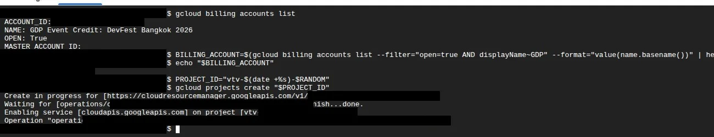

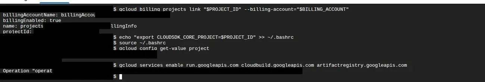

Expected: `gcloud billing accounts list` shows an open account named
`GDP Event Credit: DevFest Bangkok 2026`, `echo` prints its ID (like `01ABCD-23EFGH-45IJKL`), and
`gcloud config get-value project` prints your new `vtv-...` project. Project IDs are global, so the
date and a random number keep yours unique. If Cloud Shell asks you to authorize, click **Authorize**.

Now point `agy` at your project, so it uses Gemini through Agent Platform, paid by the credit.
Cloud Shell already knows who you are, so there is no extra sign-in:

```sh
gcloud services enable aiplatform.googleapis.com
echo 'export AGY_ADC_AUTH=true GOOGLE_CLOUD_QUOTA_PROJECT=$CLOUDSDK_CORE_PROJECT' >> ~/.bashrc
source ~/.bashrc
```

Copy the `echo` line exactly, with the single quotes. It must come after the
`CLOUDSDK_CORE_PROJECT` line in `~/.bashrc`, so run it after the block above.

- `echo "$BILLING_ACCOUNT"` prints nothing: the credit is not visible yet. Wait 1-2 minutes and run
  the two `BILLING_ACCOUNT=` lines again. Still empty after 5 minutes? Check the claim page said it
  succeeded, and that Cloud Shell uses the same `@gmail.com`.
- A `gcloud billing ...` command fails with HTTP 429 (too many requests): wait 15 seconds and run it
  again.
- `services enable` says billing is not enabled: the link has not landed yet. Wait a minute and run
  it again.

> **The credit and what it pays for.** The credit is about $5. One build on Gemini 4 Argon costs
> about $1.70, so the credit covers **one Argon build per person**, the deploy and a spare.
> `agy` does not show the cost. To see it: Cloud console > **Billing** > **Reports**, and open
> **Live costs by SKU** (near real time; the normal report and the Credits page take hours to catch up).
> Gemini 3.8 Flash through your project is **not** cheaper than Argon. For a second build, use the
> free Flash (box in section 2.1).
>
> 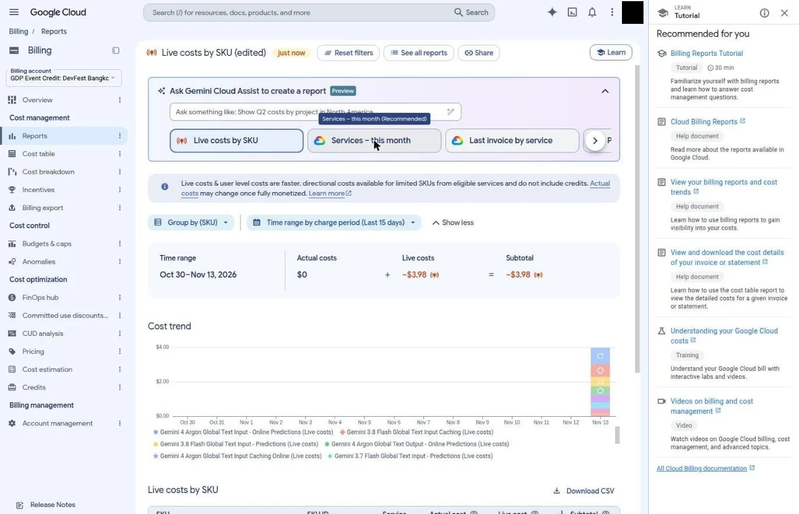

---

## 2. Start agy on Argon, then the spec and plan: Gates 1 and 2 (minutes 5-10)

### 2.1 Start `agy` on Gemini 4 Argon

In the starter folder (in a new tab, `cd vibe-to-verified-starter` first):

```sh
agy
```

The first time, `agy` walks you through a few screens:

1. Pick a colour scheme (Enter).
2. **Migration options**: leave "Import extensions from Gemini CLI" unticked and choose **[Next]**.
3. **Terms**: the Google Cloud terms. Choose **[Done]**.
4. Trust the folder: yes.

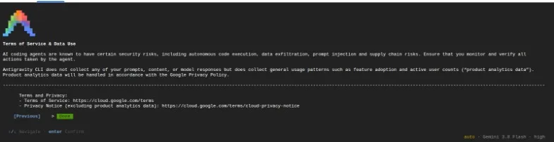

Check the banner at the top: it says `ADC: <your e-mail> (Agent Platform)` and
`GCP Project: vtv-...`. It asks "Select login method" instead? The variables are not loaded:
`/exit`, run `source ~/.bashrc`, then `agy` again.

Now choose the model. Type `/`, wait for the menu, type `model`, Enter. Choose **Gemini 4 Argon**
(effort Medium), Enter. The list shows Google models only.

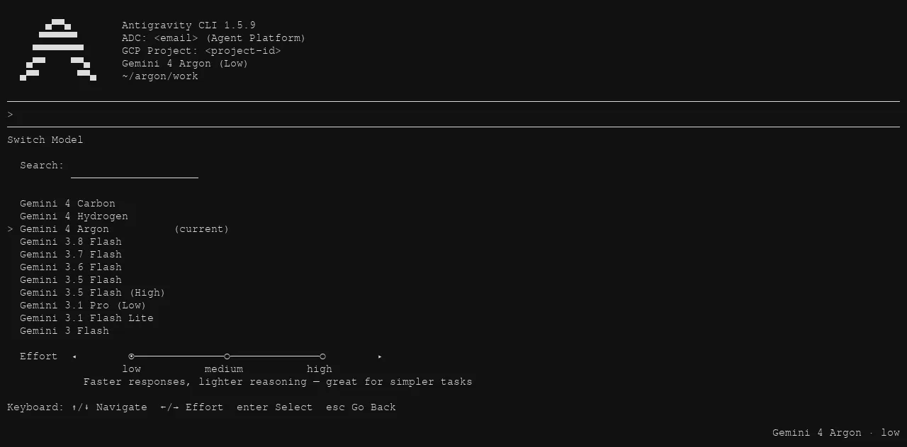

The bottom-right corner now says `auto · Gemini 4 Argon · medium`. `agy` remembers the model next time.

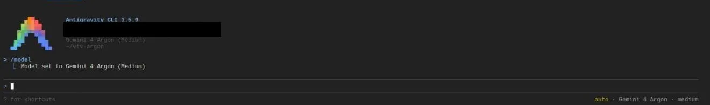

> **No credit, low credit, or a second build: free Flash.** Remove the Agent Platform line and open
> a new Cloud Shell tab (the **+** button; `source ~/.bashrc` alone does not remove variables that
> are already set):
>
> ```sh
> sed -i '/AGY_ADC_AUTH/d' ~/.bashrc
> ```
>
> In the new tab, `cd vibe-to-verified-starter` and run `agy`. At "Select login method" choose
> **1. Google OAuth**. Click **Click here to authenticate**, choose your `@gmail.com`, **Sign in**,
> then **Copy to Clipboard**, go back to Cloud Shell, paste the code (Ctrl+V, or Cmd+V on a Mac) and
> press Enter. On **Terms of Service & Data Use** the data box may be ticked: Enter unticks it; then
> press Down (it lands on **[Previous]**) and Right to **[Done]**, Enter. The banner then shows no
> "(Agent Platform)". Type `/model` and choose **Gemini 3.8 Flash** if it is not already chosen
> (`agy` may remember Argon). Free Flash builds take a few minutes longer.
>
> 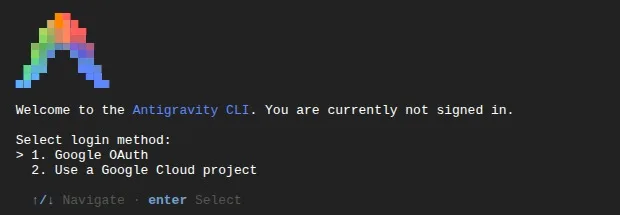

### 2.2 Read the spec (Gate 1)

Open `docs/brief.md`, then `conductor/tracks/qa_board_20261028/spec.md` (in Cloud Shell:
`cloudshell edit docs/brief.md`, or the **Open Editor** button). Check:

- Are all four acceptance criteria from the brief there, word for word, with the `[ui]` tags?
- Does it say the core is read-only?
- Is anything invented that the brief does not ask for?

**Gate 1 spec approved** when it is right. Do not approve to be polite. A wrong spec makes
everything after it wrong.

### 2.3 Read the plan (Gate 2)

Open `conductor/tracks/qa_board_20261028/plan.md`. Check:

- Every task points to `src/ui/`. Anything touching `src/core/`, `CORE.lock` or `scripts/` is wrong.
- Tests are written with the code, in `src/ui/**/*.test.ts`.
- The last task runs `npm run verify:contract`.

**Gate 2 plan approved** when it is right. You tell the agent in the next step.

> **Stuck?** `git fetch origin`, then `git switch step-1-spec` gives you the approved spec and plan.

---

## 3. Build (minutes 10-40, together with section 4)

Build and verify are one stage of 30 minutes: the agent builds, then runs `/verify` itself, and you
pass Gate 3 inside the same window. In our test runs the build took about 9 minutes on Gemini 4 Argon
and 13 to 16 minutes on the free Gemini 3.8 Flash, from the paste below to `VERIFY.md`; the rest of
the window is for your checks and for slower runs.

**One Argon build per person.** If you want to build again, switch to the free Flash first (box in
section 2.1).

### 3.1 Check the mode, then build

Look at the bottom-right corner of `agy` **every time you start it**. It must say `auto`. If it shows
no mode word (default) or `accept-edits`, press **Shift+Tab** until it says `auto`
(Shift+Tab cycles default, accept-edits, auto).

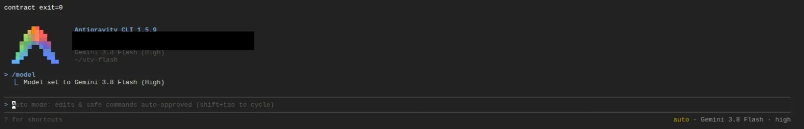

Paste this to start the build:

```
Gate 1 and Gate 2 approved: spec and plan in conductor/tracks/qa_board_20261028/. Build it.
```

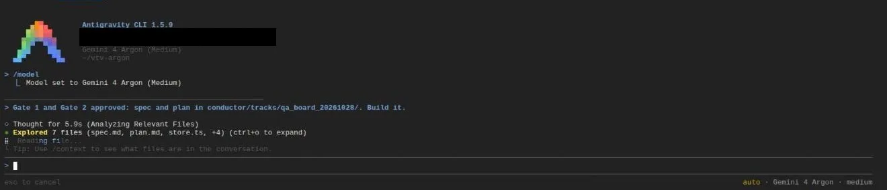

**In auto mode nothing waits for you.** The agent edits files and runs commands without asking, in a
sandbox. You approve nothing during the build, so **your two checks are the safety: the lock check
(3.2) and reading `VERIFY.md` (4). Both are mandatory, every time.** The red flags you look for after
the build:

- any change to `src/core/`, `CORE.lock`, `scripts/`, `.github/`, `package.json` or
  `package-lock.json` (including a new dependency)
- a test that is deleted, skipped or weakened

The agent normally builds everything in one long turn, writes `src/ui/app.ts` and tests, and runs
`/verify` itself. If it stops before building, say: `Gate 2 approved. Build it.`
Conductor's per-phase manual checks may be skipped; that is fine, Gate 3 is where you check.
The agent can be quiet for a minute or more while it thinks or while the checker works: that is
normal, wait. On Argon it may leave all changes uncommitted (the sandbox blocks writes to git): that
is fine, `git status` shows them.

A small fix in `src/ui/app.test.ts` after a type error (for example `items[0]` becoming `items[0]?`)
is normal: the test still checks the same thing. Deleting or replacing a test is not.

Look at the full diff inside `agy` at any time:

```
/diff
```

> **Ended up in default mode?** Then every command and file change asks first. For commands, choose
> option 2 (`Yes, and always allow in this conversation ...`); file changes have no "always" option,
> approve them one by one. **Never choose option 3** (`... (Persist to settings.json)`): it keeps the
> allowance after the lab, for every project. If the agent asks to run `git config user.name`,
> choose **No**: set your own name in a second tab (section 0.3), then say `Continue the build.`

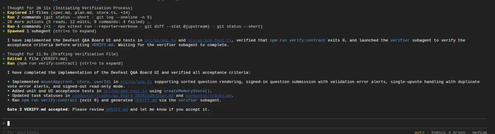

### 3.2 Check the lock (mandatory)

When the agent says it is done and waits for Gate 3, open a second Cloud Shell tab (the **+**
button) so `agy` keeps running in the first one. Click inside the new terminal before you type
(Enter with the focus still on the **+** button opens yet another tab). In that second tab (your own
terminal, not the agent):

```sh
cd vibe-to-verified-starter
npm run verify:contract
echo $?
git status --short
git diff --stat origin/step-1-spec
git diff --stat origin/step-1-spec -- src/core CORE.lock scripts .github package.json package-lock.json
```

Expected:

- `echo $?` prints `0`. The core is locked: the store rules and their tests are untouched, so the
  rules test is still green even though the agent wrote a whole UI. That is the point of the lock:
  the agent can be wrong in `src/ui/`, but it cannot break the part that guards your data.
- `git status --short` and the first `git diff --stat` list only files in `src/ui/`,
  `conductor/` and `VERIFY.md`.
- The last command prints **nothing**. Anything it prints is a red flag: tell the agent not to touch
  it and to fix `src/ui/` only.

If `verify:contract` fails, paste the last 20 lines to the agent and ask it to fix `src/ui/` only.

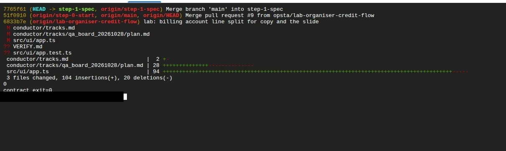

See it run:

```sh
npm run dev -- --port 8080
```

Then click **Web Preview** (top right of Cloud Shell) > **Preview on port 8080**. If the button
shows no menu, click the `http://localhost:8080/` link in the terminal: Cloud Shell opens it as a
preview. You should see the list, an ask box and vote buttons. The preview address works only for
you; to show your app to someone else, use your Cloud Run URL from section 5. Stop the server with
Ctrl+C when you are done.


> **Stuck or out of credit at minute 30 with no build yet?** `git switch step-3-build` gives you a
> finished build: start `agy` there and run `/verify` (section 4).

---

## 4. Verify: Gate 3 (still minutes 10-40)

The build says "done". Now prove it. The agent normally runs `/verify` during the build; if there is
no `VERIFY.md` yet, run, inside `agy`:

```
/verify
```

The `verified` plugin runs the contract, the tests, `git diff --stat` and `git status` itself, then
hands their output to a fresh read-only checker that only reads files. The browser check runs only
if you give the agent an app URL; in Cloud Shell expect a UI test as the evidence and check the app
yourself in Web Preview. It writes `VERIFY.md`. **The screen may stay quiet for a few minutes while
the checker works.** That is normal: wait, do not cancel.
Expected: a table with one row per acceptance criterion, with evidence and a result.

**Read `VERIFY.md` yourself (mandatory)** (`cloudshell edit VERIFY.md`, or the editor):

- Every criterion has evidence you can see (a test name, a command exit code, the test output).
- A row marked `not evidenced: <why>` is a gap, not a pass: ask the agent to add a test for it,
  then run `/verify` again.
- **Untested criteria** says `none`. Anything listed there is a gap, not a pass.
- **Tests modified** lists only the new tests in `src/ui/` (for example `src/ui/app.test.ts`).
  That is expected. A test outside `src/ui/` (core or rules tests), or a deleted, skipped or
  weakened test, is a red flag: open the diff and ask why.
- **Core files touched** says `none`, and matches your lock check.

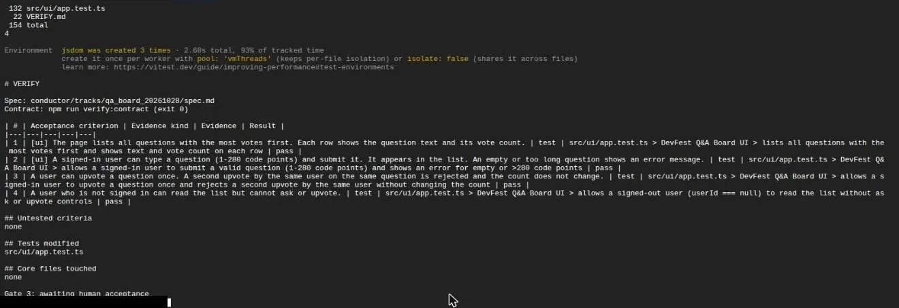

**Gate 3 VERIFY.md accepted.** If it is honest and complete, tell the agent: `Accepted.` If not,
say what is missing and run `/verify` again. Only a person can pass this gate.

If Conductor then asks whether to run a formal code review, answer **No**: it takes time you do not
have, and you have just reviewed the evidence yourself.

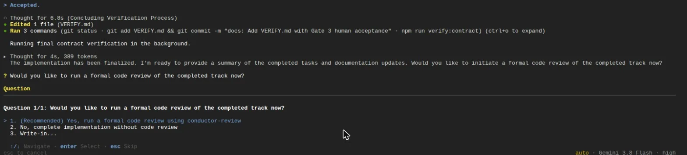

> **Stuck at minute 40?** `git switch step-4-verified` has a verified build with its `VERIFY.md`.

---

## 5. Publish (minutes 40-50)

You set the project and enabled the services in section 1. Skipped that? Run the section 1 commands
now, then wait 1 minute before you deploy. Check that the CLI still points at your `vtv-...` project:

```sh
gcloud config get-value project
```

Empty or wrong? Run `source ~/.bashrc` (or the section 1 commands again).

Deploy:

```sh
gcloud run deploy vtv --source . --region asia-southeast1 --allow-unauthenticated
```

Say yes if it offers to create an Artifact Registry repository. Expected: the first deploy on a
fresh project takes 1-4 minutes (the build plus creating the repository), then it prints
`Service URL: https://vtv-....run.app`. Open it.

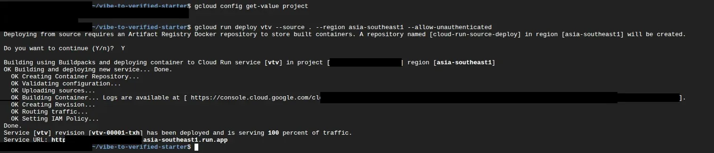

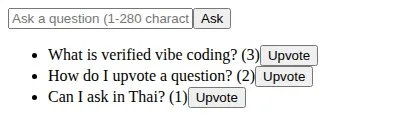

Without Firebase settings the deployed app uses an in-memory store and a demo user. That is fine
for the lab: you see your own working app on a public URL. To connect a real Firestore later, see
`docs/deploy.md`.

> **Stuck?** `git switch step-5-deployed` is the final state; deploy it with the same command.
> Cloud Run errors: `PERMISSION_DENIED` on Artifact Registry right after enabling? Wait 1 minute and
> run the same deploy again (it may take two tries). Otherwise read the last lines of the build log
> first; the usual cause is billing not linked to the project yet: run `gcloud billing projects link` from section 1 again.

---

## 6. Speaker demo and wrap (minutes 50-60)

Watch, no typing. The speaker pushes to `main` of this repo and the pipeline takes over
(`.github/workflows/ci.yml`, then `.github/workflows/pipeline.yml`):

1. **ci**: unit tests, Firestore rules tests in the emulator, core lock check, test guard.
2. **Secret scan**: gitleaks over every commit.
3. **Deploy**: Cloud Run, signed in with Workload Identity Federation (no JSON keys).
   It runs only when 1 and 2 are green.

In your own fork the deploy job is skipped (it needs repo variables you do not have), so your
runs stay green. Then the A/B numbers: what it costs to read a backend an agent wrote in full,
against a locked core.

Take-home loop: **spec, plan, build, verify, ship**, with a human at each gate.
Keep your repo: `VERIFY.md` is the habit to take home. More: https://g.dev/ai/build

---

## Doing this after the event

The event credit lasts about 12 hours. To do the lab later on your own:

- **Model, free**: skip the Agent Platform lines in section 1 and use the free Gemini 3.8 Flash
  (box in section 2.1, option 1 Google OAuth). Its free quota is enough for the lab.
- **Model, Argon**: use your own billing account in section 1 (set `BILLING_ACCOUNT` to its ID
  from `gcloud billing accounts list`). Argon costs about $1.70 per build on Agent Platform; check
  Billing > Reports > Live costs by SKU.
- **Deploy**: Cloud Run needs a billing account on the project, but it has a free tier, and this
  small app stays well inside it.
- Section 0 and sections 2 to 5 are the same. Delete the project when you are done, so nothing keeps
  running: `gcloud projects delete "$CLOUDSDK_CORE_PROJECT"`.

---

## Fallback box (no terminal works for you)

If you cannot use Cloud Shell or `agy` (under 18, Google does not know your age, work account, sign-in
fails) and have no laptop set up (Appendix A):

1. Open https://aistudio.google.com/apps (Build > New app). Sign in with any account AI Studio accepts.
2. Paste the contents of `docs/brief.md` into "Describe an app" and send it. Keep "Default mode".
   It takes about 5 minutes.
3. For Gate 3, check the four criteria one by one in the Preview pane. Write what you saw.
   The app keeps its data in your browser; that is fine for the lab.
4. Publishing is optional: Publish > Get started asks for a Google Cloud project with billing.
   Only do it if you claimed the event credit; otherwise stop at the Preview.

Or stay in the terminal: `git switch step-3-build`, then continue from section 4.

---

## Appendix A: install on your own laptop

Use this only if Cloud Shell does not work for you. It needs a personal `@gmail.com` (18 or older,
work and school accounts do not work with Google Antigravity) and a laptop you can install software on.
Do it before the lab if you can: it takes about 20 minutes.

1. Install **git**, **Node.js LTS 22 (22.12+), 24 or 26** (not 23 or 25) and **Python 3**.
2. Install `agy`:
   - macOS or Linux: `curl -fsSL https://antigravity.google/cli/install.sh | bash`
   - macOS with Homebrew: `brew install --cask antigravity-cli`
   - Windows (PowerShell): `irm https://antigravity.google/cli/install.ps1 | iex`

   Check with `agy --version`. Not found? Open a new terminal; on macOS/Linux add `~/.local/bin` to `PATH`.
3. Install the Google Cloud CLI (https://cloud.google.com/sdk/docs/install) and run
   `gcloud auth login` with the same `@gmail.com`.
4. Follow section 0.3 (git name, clone, plugins), then sections 1 to 5 with these differences:
   - Section 1: on a laptop the gcloud setting lasts, so run
     `gcloud config set project "$PROJECT_ID"` instead of the `echo ... >> ~/.bashrc` and `source` lines.
   - Model: the simplest is the free Flash (box in section 2.1: Google OAuth, option 1). For Argon on
     a laptop, also run `gcloud auth application-default login` and set `AGY_ADC_AUTH=true` and
     `GOOGLE_CLOUD_QUOTA_PROJECT` to your project ID in your shell profile.
   - Exit codes: `echo $?` on macOS/Linux, `echo $LASTEXITCODE` in PowerShell.
   - Section 3.2: run `npm run dev` and open the address it prints (no Web Preview).
   - Windows: line-ending noise is safe, the lock check ignores CRLF.

## Troubleshooting

| Problem | Try |
|---|---|
| Cloud Shell says you cannot use it (age) | Under 18 or Google does not know your age: use Appendix A or the fallback box |
| Cloud Shell says "Verify your account" | Click **Verify**, scan the QR code with your phone (or use SMS), then click **Refresh** |
| Cloud Shell first start is slow | The first start of the day takes 2-3 minutes; wait |
| Installer prints `ERROR: logging before google.Init` | Harmless. Run `source ~/.bashrc` |
| `agy --version` prints 1.4 | Cloud Shell's old `agy` comes first: `source ~/.bashrc` |
| `agy: command not found` | Cloud Shell: `source ~/.bashrc`. Laptop: new terminal; add `~/.local/bin` to `PATH` |
| `npm ci` reports vulnerabilities | Ignore them. Never run `npm audit fix`: it changes the locked `package.json` |
| `agy` asks "Select login method" but you want Argon | The variables are not loaded: `/exit`, `source ~/.bashrc`, `agy`. Check the line from section 1 is in `~/.bashrc` |
| `agy` says a Gemini 4 model "is not recognized" | `GOOGLE_CLOUD_QUOTA_PROJECT` is missing: `/exit`, `source ~/.bashrc`, `agy` |
| No "(Agent Platform)" in the banner after switching back from free Flash | Expected: the free path uses your Google sign-in |
| Bottom-right corner does not say `auto` | Press Shift+Tab until it does (default, accept-edits, auto) |
| Sign-in code does not paste (free Flash) | Click in the terminal, then Ctrl+V (Cmd+V on a Mac); allow clipboard access if the browser asks |
| Sign-in loop (free Flash) | Use the personal `@gmail.com`; option 1, Google OAuth; try a private window |
| Claim page asks for a profile | A Google Developer Program profile is required: click **Create profile**, finish it, then claim |
| No smartphone for the human check | Borrow a neighbour's phone to scan the QR code, or ask a helper; otherwise use free Flash and the fallback box |
| Credit not visible right after claiming | Normal: it takes 3-5 minutes. Then look for the billing account `GDP Event Credit: DevFest Bangkok 2026` |
| Console shows a Welcome / country / Terms dialog | First visit: choose your country, tick the Terms box, **Agree and continue** |
| Console offers a $300 Free Trial ("Start free") | Do not click it during the lab: it asks for a card. The event credit is enough |
| `gcloud billing accounts list` is empty | Wait 3-5 minutes after claiming; check Cloud Shell uses the same `@gmail.com` as the claim |
| `gcloud billing ...` fails with HTTP 429 | Too many requests at once: wait 15 seconds and run it again |
| `gcloud projects create` fails | ID taken or invalid: run the `PROJECT_ID=` line again, then create again. Too many projects: reuse one of yours |
| Two or more `GDP` accounts in the list | Use the open one named `GDP Event Credit: DevFest Bangkok 2026`: `BILLING_ACCOUNT=<ACCOUNT_ID>` with its ID, then link again |
| `gcloud billing projects link` fails | `$BILLING_ACCOUNT` empty (wait, rerun that line) or the account is closed; use the open `GDP Event Credit` one |
| `gcloud config get-value project` empty in a new tab | `source ~/.bashrc`; if still empty, redo the section 1 commands |
| How much have I spent? | Billing > Reports > **Live costs by SKU**. One Argon build is about $1.70; the credit covers one build, the deploy and a spare |
| Credit used up, or a second build | Free Flash: box in section 2.1 |
| `npm ci` fails | `node -v` must be an LTS: 22 (22.12+), 24 or 26. Not 23 or 25 |
| `gcloud` asks you to sign in | Cloud Shell: click Authorize. Laptop: `gcloud auth login` with the same `@gmail.com` |
| Agent asks to run `git config user.name` | Choose No. Set your own name in a second tab (section 0.3), then say `Continue the build.` |
| Web Preview shows no menu | Click the `http://localhost:8080/` link in the terminal |
| Web Preview shows nothing | The dev server must run with `--port 8080`, and Web Preview must use port 8080 |
| Pressing Enter opens more Cloud Shell tabs | The focus is on the **+** button: click inside the terminal first |
| Conductor asks for a formal code review after Gate 3 | Answer No |
| `PERMISSION_DENIED` on `artifactregistry.repositories.get` right after enabling the services | The services are still switching on: wait 1 minute and run `gcloud run deploy` again (it may take two tries) |
| `git switch step-1-spec` says invalid reference | `git fetch origin` first |
| `core lock` / `check:core` fails | You or the agent changed a locked file: `git checkout -- src/core CORE.lock` |
| You pressed No and the agent stopped (default mode) | Normal: type what to do instead, then `continue` |
| Agent edited a test to pass | Tell it: "Do not change tests. Fix `src/ui/`." Then run `/verify` again |
| Agent added a package | Tell it to remove it: the rules say no new dependencies. Check with the lock check (3.2) |
| Cloud Shell tab disconnected | Open it again, `cd vibe-to-verified-starter`; your files and the `~/.bashrc` lines are kept |
| Quota or credit exhausted | `git switch` to the next checkpoint |
