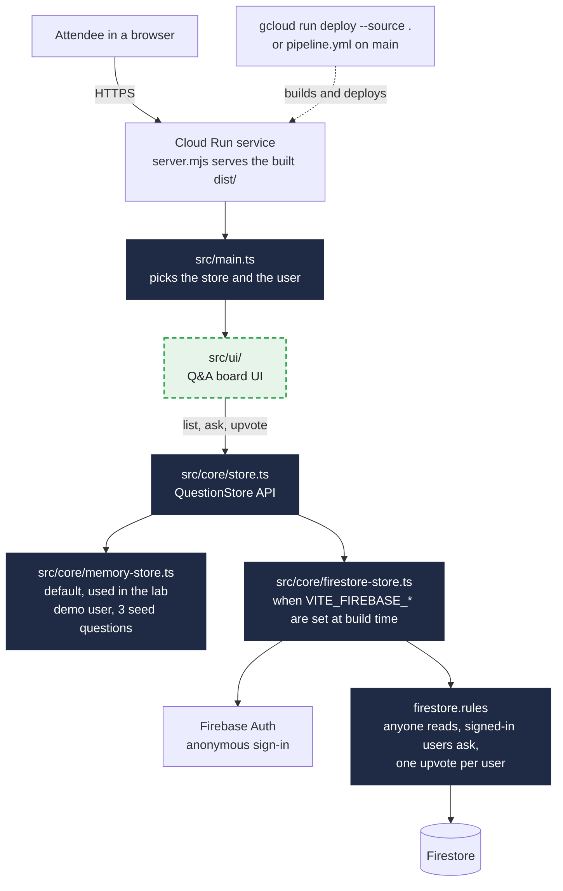

# vibe-to-verified-starter

Starter repo for the DevFest 2026 talk "Fix the Core, Generate the Edges" and the lab in [LAB.md](LAB.md).

A small Q&A board on Firebase. Humans own a small, locked, tested core (`src/core/`, `firestore.rules`,
the rules tests and the check scripts). An agent writes only the edges in `src/ui/`. The rules for the agent are
in [AGENTS.md](AGENTS.md). The list of locked files is in [CORE.lock](CORE.lock).

## How the app works



Green, dashed: the edge, written by the agent. Dark: the locked core, listed in `CORE.lock`. The UI talks to the core
only through the `QuestionStore` API (`list`, `ask`, `upvote`).

- **Memory store (the lab):** without `VITE_FIREBASE_*` the app keeps the questions in the browser tab, so they reset
  on reload. Everyone is the demo user; add `?signedOut` to the URL to see the signed-out view.
- **Firestore:** with the Firebase settings from [docs/deploy.md](docs/deploy.md), users sign in anonymously and
  `firestore.rules` decides who may ask and upvote.

```sh
npm ci
npm run verify:contract   # type check, unit tests, core check, test check, banned-word check
```

## Delivery pipeline (speaker demo)

On a push to `main`, [ci.yml](.github/workflows/ci.yml) runs the unit tests, the Firestore rules tests in the emulator,
the core lock check and the test guard. When it is green, [pipeline.yml](.github/workflows/pipeline.yml) scans every
commit for secrets with gitleaks and then deploys to Cloud Run with Workload Identity Federation (no JSON keys).

The deploy job runs only when the repo variables `GCP_PROJECT_ID`, `GCP_REGION`, `GCP_WIF_PROVIDER`, `GCP_DEPLOYER_SA`,
`GCP_RUNTIME_SA`, `GCP_BUILD_SA` and `CLOUD_RUN_SERVICE` are set. A fork has none of them, so deploy is skipped and
the run stays green.

## Make the lock enforceable

`CORE.lock` catches accidental edits: `node scripts/check-core.mjs` fails when a locked file no longer matches its
hash. It does not stop a change that edits a locked file and its hash in `CORE.lock` together, because the lock
lives in the same repo the agent writes to. CODEOWNERS plus required review on the core makes it enforceable.

In your own fork:

1. Add `.github/CODEOWNERS` that names a human reviewer for the core, for example:

   ```
   # Locked core: a human code owner must approve every change here
   /src/core/                 @your-github-user
   /firestore.rules           @your-github-user
   /firebase.json             @your-github-user
   /test-rules/               @your-github-user
   /scripts/                  @your-github-user
   /CORE.lock                 @your-github-user
   /package.json              @your-github-user
   /.github/                  @your-github-user
   ```

2. In the fork's settings, add a branch protection rule (or ruleset) for `main` and turn on:
   - **Require a pull request before merging**
   - **Require review from Code Owners**
   - **Require status checks to pass** with the CI job from `.github/workflows/ci.yml`
   - **Do not allow bypassing the above settings**, so admins and bots follow the same rule

Then an agent can still propose a change to the core, but it cannot merge one. A human code owner reads it first.

This repo does not ship a real CODEOWNERS file, because the owner must be someone in your own fork.

### Limits

What you need before the lock is enforced:

- **GitHub:** a public fork works on the free plan. A private repo needs GitHub Pro, Team or Enterprise for branch
  protection or rulesets. The CODEOWNERS file alone only requests reviews; it blocks nothing.
- **GitLab:** Code Owners and "Required approval from code owners" need Premium or Ultimate. On Free you can still
  protect `main` (who may push and merge), but approvals are not required.
- **The agent's identity:** run the agent with its own account or token (a bot user or app) that has write access,
  not admin. If it pushes as you, you cannot approve your own pull request. If its token is an admin's, it can
  change the protection rules themselves.

Without these, `CORE.lock` still catches accidental edits. Keep the human check from the lab: before you merge,
read `git diff --stat` for the core paths (LAB.md 3.2). Any line it prints is a core change that a person must review.
